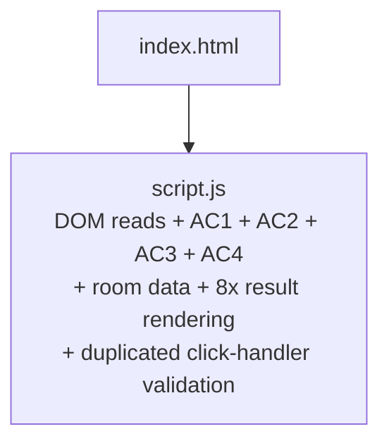
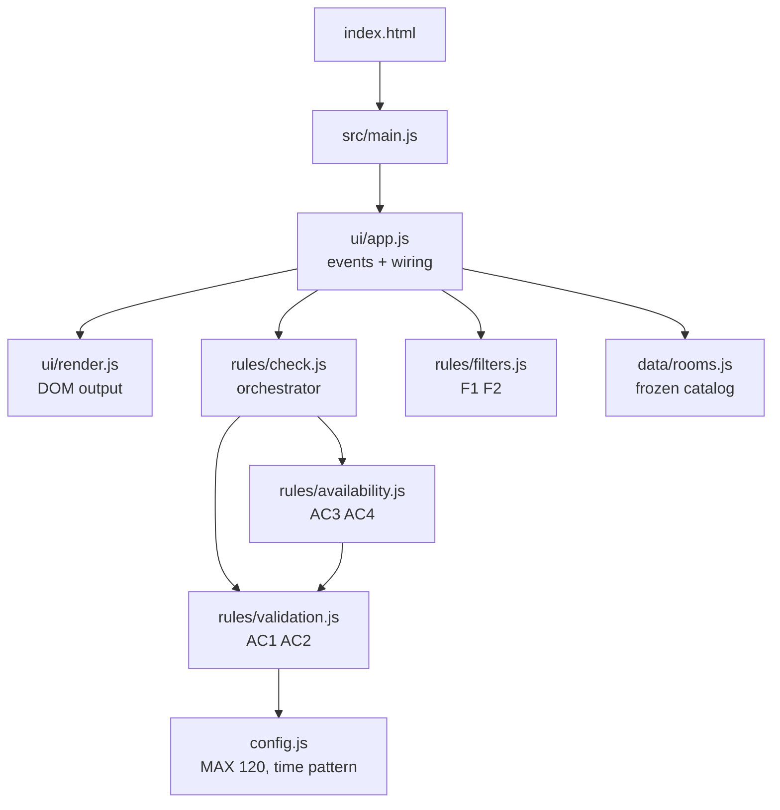

# Tasks #02, #03, #05 - Design, refactoring and quality evidence

## 1. Architecture before / after

**Before (v1)** - one file mixes UI, validation, rules and data:

**After (v2)** - rules know nothing about the DOM:

## 2. Design decisions

1. **Rules are pure functions without DOM access** (`rules/*`). Reason: they can be tested from Node with `node --test` and no browser. Trade-off: one more layer (`ui/app.js`) to connect input to rules.
2. **`config.js` is the single source of the 120-minute limit.** Reason: in v1 the number and its message were duplicated (L43/L84). In v2 the error text is built from the constant, so limit and message cannot diverge. Evidence: `grep -rn 120 src` finds it only in `config.js`.
3. **`checkRoomAvailability(room, ...)` receives the room as an argument.** Reason: a check can only see the bookings of the room it was given, which prevents using another room's data. Tested in `rooms.test.js` ("each room uses its own bookings").
4. **Data is deep-frozen** (`deepFreeze` in `data/rooms.js`) for AC5. Reason: attempts to mutate bookings throw `TypeError` in ES modules (strict mode), which tests assert.
5. **`doc` is injected into `initApp`.** Reason: the UI controller is testable with a 50-line fake DOM and no extra dependency such as jsdom.

## 3. Quality comparison (v1 vs v2)

| Metric | v1 | v2 | How it was obtained |
|--------|----|----|---------------------|
| Automated tests | 0 | 41 passed / 41 | `node --test` in `v2-final`, output in `docs/test-results.txt` |
| Manual checks | 9/9 pass (AC1, AC2, AC4) | 9/9 equivalent checks covered by tests | `docs/baseline-v1-results.txt` (harness run on v1) |
| Places where the 120-minute limit is defined | 2 (`script.js` L43, L84) | 1 (`config.js`) | `grep -n 120` in v1, `grep -rn 120 src` in v2 |
| Duplicated validation blocks | 2 (handler + `checkAvailability`) | 0 (`validateTimeRange` only) | code review of v1 L24-L47 vs L77-L89 |
| Result-rendering call sites | 8 (`box.className = ...`) | 1 (`renderResult`) | `grep -n "box.className" script.js` vs `src/ui/render.js` |
| DOM access inside rule code | yes (`getElementById` x6) | none | `grep -rn getElementById src/rules src/data src/config.js` = 0 matches |
| Files / modules | 2 files (129 lines) | 11 source files + 5 test files | `wc -l`, `ls` |
| Rooms | 1 | 5 (1 blocked), each with own bookings | `src/data/rooms.js` |
| Mobile layout | responsive, 1 breakpoint | responsive; no horizontal overflow at 375 px | Playwright run, `docs/browser-check-results.txt`, screenshots in `docs/` |

Line count grew (129 -> 468 incl. HTML/CSS) because v2 adds features (rooms, filters, empty state). Size was not a quality goal.

## 4. Remaining limitations

- No persistence: bookings are fixed fictional data; a successful check does not create a booking.
- "Current time" is a fixed label; bookings in the past are not handled.
- UI is tested through a fake DOM and one Playwright smoke run, not a full end-to-end suite in CI.
- Times are same-day only; no overnight ranges.
- Ambiguity decided by me: a blocked room still appears in the list (marked "blocked") but is never reported available.

## 5. Behaviour note found during testing

`runCheck` validates time first, so a blocked room with an invalid range shows the time error, not "blocked". This is covered by a test (`validation errors come before availability`) and was kept on purpose.
