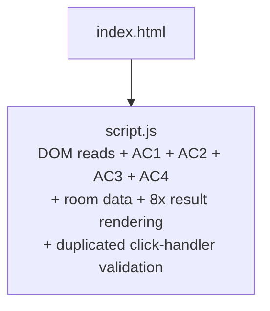
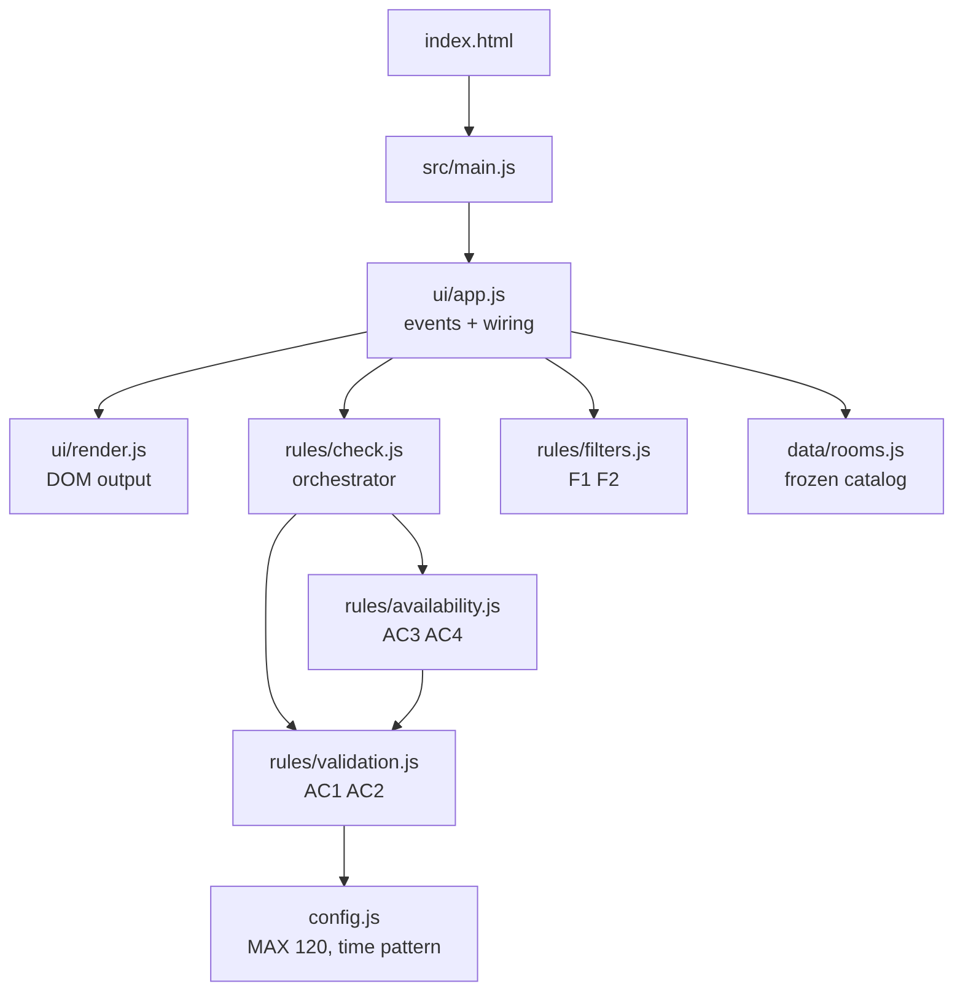
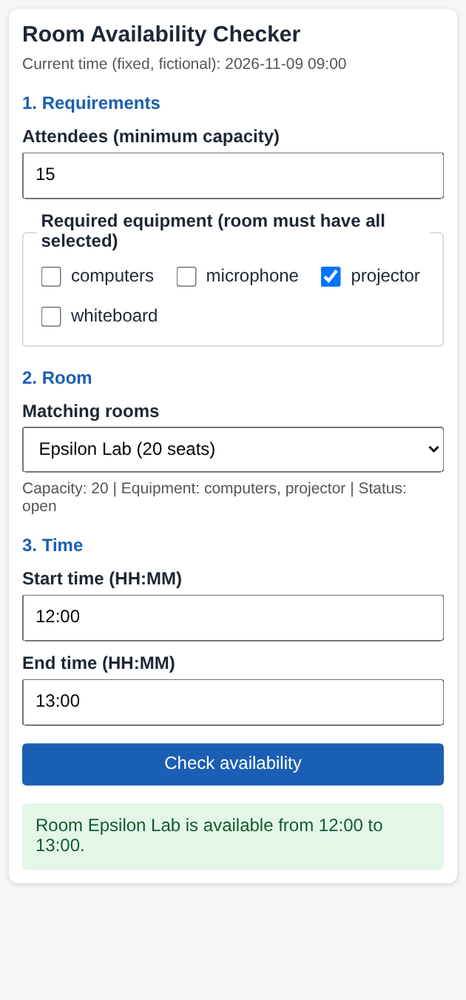
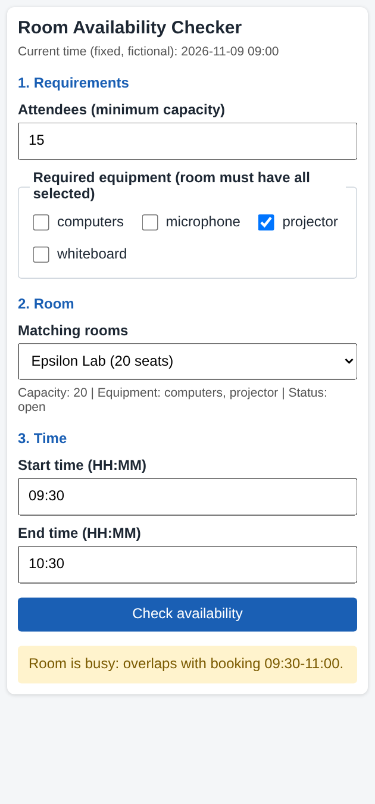
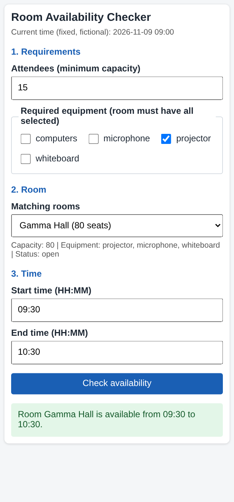
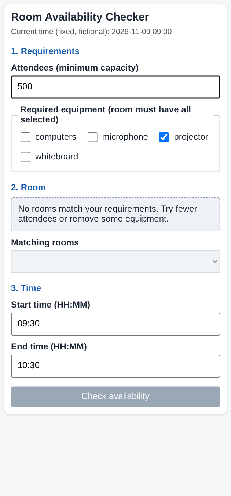

# Smart Campus Room Availability Checker - Assignment #04 report

**AI assistant used:** Claude (Anthropic), model claude-sonnet-5-5, session date 2026-11-08.

Repository: `v1-initial/` (baseline commit `b82d77c`, tag `v1-baseline`), `v2-final/` (final). Run commands are in `README.md`.


# Task #01 - Codebase analysis (v1 baseline)

Baseline commit: `b82d77c` (tag `v1-baseline`). All line numbers refer to that commit.

## 1. Repository map (context given to the AI assistant)

```
v1-initial/
├── index.html   (38 lines)  page markup + inline CSS; loads script.js
└── script.js    (91 lines)  everything else
    ├── room (L5-14)                 data: one room R101, 3 frozen bookings
    ├── NOW (L16)                    fixed "current time" constant
    ├── toMinutes(t) (L18)           "HH:MM" -> minutes
    ├── checkAvailability() (L23)    DOM read + AC1 + AC2 + AC3 + AC4 + DOM write
    └── click handler (L71)          DOM read + partial AC1/AC2 re-check, then calls checkAvailability()
```

## 2. Acceptance criteria and constraints given to the AI

- AC1 valid time (HH:MM, start < end)
- AC2 maximum 120 minutes
- AC3 blocked room cannot be booked
- AC4 overlap = busy, touching boundaries = free
- AC5 booking data immutable
- AC6 clear, responsive feedback
- Constraints: no login, payments, live APIs or database; fictional data only; no full rewrite - small steps.

## 3. Baseline evidence

`docs/baseline-v1-results.txt`: 9/9 manual-equivalent checks pass (AC1, AC2 at 120/121, AC4 overlap and touching).
Automated test suite: none (0 tests). Size: 38 + 91 = 129 lines.

## 4. Maintainability risks (with file/function references)

| # | Risk | Evidence | Impact |
|---|------|----------|--------|
| R1 | **Duplicated validation** | `script.js` click handler L77-89 re-implements the empty-input check and the 120-minute check that `checkAvailability()` already does (L29-L47). The literal `120` and the message "Booking cannot be longer than 120 minutes." appear twice (L43/L45 and L84/L86). | Changing the limit in one place and forgetting the other creates inconsistent behaviour. |
| R2 | **Business rules mixed with DOM** | `checkAvailability()` reads `document.getElementById` (L24-L26) and writes `box.className`/`box.textContent` in 8 places (L30-L86). Rules cannot be called without a browser. | Rules cannot be unit-tested in Node; every test needs a DOM. |
| R3 | **Hard-wired single-room data** | `checkAvailability()` reads the global `room` (L5) directly (L48, L55-L60). It takes no room parameter. | Adding more rooms (new feature) would force edits inside the rule code and risks using another room's bookings. |
| R4 | **Duplicated rendering logic** | 8 separate `box.className = ...; box.textContent = ...` pairs (L30, 37, 44, 51, 61, 67, 78, 85). | Any change to result styling or ARIA must be repeated 8 times. |
| R5 | **Dead / unused config** | `NOW` (L16) is declared but never read; the fixed time exists only in the HTML text (`index.html` L28). | Misleading constant; two sources of truth for "current time". |
| R6 | **Time regex duplicated inline** | The same regex literal appears twice in one condition (L29). | Minor, but easy to desynchronize. |

## 5. Prioritized improvement plan (before editing code)

| Priority | Step | Fixes | Reason |
|----------|------|-------|--------|
| P1 | Add automated tests around the **current** behaviour (AC1-AC5) | - | Safety net before any refactoring |
| P1 | Extract constants to `config.js` (MAX_DURATION=120, NOW) | R1, R5 | Smallest change, removes magic numbers |
| P1 | Extract time validation to `rules/validation.js`, single source for both checks | R1, R6 | Removes the duplicated validation |
| P1 | Extract overlap/blocked logic to `rules/availability.js`, taking `room` as an argument | R2, R3 | Needed before multiple rooms |
| P2 | Move room data to `data/rooms.js` (4+ rooms, each with own bookings) | R3 | Prepares the new feature |
| P2 | One `render.js` function for results | R4 | Single place for UI feedback |
| P2 | Add `rules/filters.js` (capacity, equipment), room selector, empty state | New F1-F5 | The new feature, built on clean modules |
| P3 | Tests for F1-F5, integration test, quality comparison table | - | Evidence for the report |

Order rule: refactor one step at a time, run tests and review the diff after each, commit after each.

## 6. AI suggestion that was modified/rejected

> **To be confirmed by the student (must reflect what really happened).**
> Candidate from this session: the assistant's first plan said a UI-level integration test could use `jsdom`.
> Decision: modified - no dependency is added; the integration test runs at the orchestrator level (`runCheck(state)`) with Node's built-in `node --test`, plus a manual UI checklist.
> Reason: assignment requires "setup, run and test commands"; zero dependencies means `node --test` works on any machine without `npm install`.


# Tasks #02, #03, #05 - Design, refactoring and quality evidence

## 1. Architecture before / after

**Before (v1)** - one file mixes UI, validation, rules and data:



**After (v2)** - rules know nothing about the DOM:



## 2. Design decisions

1. **Rules are pure functions without DOM access** (`rules/*`). Reason: they can be tested from Node with `node --test` and no browser. Trade-off: one more layer (`ui/app.js`) to connect input to rules.
2. **`config.js` is the single source of the 120-minute limit.** Reason: in v1 the number and its message were duplicated (L43/L84). In v2 the error text is built from the constant, so limit and message cannot diverge. Evidence: `grep -rn 120 src` finds it only in `config.js`.
3. **`checkRoomAvailability(room, ...)` receives the room as an argument.** Reason: a check can only see the bookings of the room it was given, which prevents using another room's data. Tested in `rooms.test.js` ("each room uses its own bookings").
4. **Data is deep-frozen** (`deepFreeze` in `data/rooms.js`) for AC5. Reason: attempts to mutate bookings throw `TypeError` in ES modules (strict mode), which tests assert.
5. **`doc` is injected into `initApp`.** Reason: the UI controller is testable with a 50-line fake DOM and no extra dependency such as jsdom.

## 3. Quality comparison (v1 vs v2)

| Metric | v1 | v2 | How it was obtained |
|--------|----|----|---------------------|
| Automated tests | 0 | 41 passed / 41 | `node --test` in `v2-final`, output in `docs/test-results.txt` |
| Manual checks | 9/9 pass (AC1, AC2, AC4) | 9/9 equivalent checks covered by tests | `docs/baseline-v1-results.txt` (harness run on v1) |
| Places where the 120-minute limit is defined | 2 (`script.js` L43, L84) | 1 (`config.js`) | `grep -n 120` in v1, `grep -rn 120 src` in v2 |
| Duplicated validation blocks | 2 (handler + `checkAvailability`) | 0 (`validateTimeRange` only) | code review of v1 L24-L47 vs L77-L89 |
| Result-rendering call sites | 8 (`box.className = ...`) | 1 (`renderResult`) | `grep -n "box.className" script.js` vs `src/ui/render.js` |
| DOM access inside rule code | yes (`getElementById` x6) | none | `grep -rn getElementById src/rules src/data src/config.js` = 0 matches |
| Files / modules | 2 files (129 lines) | 11 source files + 5 test files | `wc -l`, `ls` |
| Rooms | 1 | 5 (1 blocked), each with own bookings | `src/data/rooms.js` |
| Mobile layout | responsive, 1 breakpoint | responsive; no horizontal overflow at 375 px | Playwright run, `docs/browser-check-results.txt`, screenshots in `docs/` |

Line count grew (129 -> 468 incl. HTML/CSS) because v2 adds features (rooms, filters, empty state). Size was not a quality goal.

## 4. Remaining limitations

- No persistence: bookings are fixed fictional data; a successful check does not create a booking.
- "Current time" is a fixed label; bookings in the past are not handled.
- UI is tested through a fake DOM and one Playwright smoke run, not a full end-to-end suite in CI.
- Times are same-day only; no overnight ranges.
- Ambiguity decided by me: a blocked room still appears in the list (marked "blocked") but is never reported available.

## 5. Behaviour note found during testing

`runCheck` validates time first, so a blocked room with an invalid range shows the time error, not "blocked". This is covered by a test (`validation errors come before availability`) and was kept on purpose.


# Task #04 - Automated testing: commands and actual results

Command: `cd v2-final && node --test` (Node 22, no dependencies). Raw output: `docs/test-results.txt`.

```
# tests 41
# suites 0
# pass 41
# fail 0
# cancelled 0
# skipped 0
# todo 0
# duration_ms 255.162348
```

Executed tests:

```
ok 1 - AC3: blocked room is reported as blocked, never available
ok 2 - AC3: blocked room wins even when it has no bookings
ok 3 - AC4: overlapping interval is busy and names the conflicting booking
ok 4 - AC4 boundary: request that ends exactly when a booking starts is free (touching)
ok 5 - AC4 boundary: request that starts exactly when a booking ends is free (touching)
ok 6 - AC4 boundary: one minute of overlap is busy
ok 7 - AC4: request fully inside an existing booking is busy
ok 8 - runCheck: free slot returns ok with room name in message
ok 9 - runCheck: validation errors come before availability (blocked room + 121 min -> TOO_LONG)
ok 10 - runCheck: blocked room returns BLOCKED error
ok 11 - F1 boundary: exact capacity passes, one more attendee fails
ok 12 - F1: insufficient capacity excludes small rooms
ok 13 - F2: room must have ALL selected equipment
ok 14 - F2: missing a single required item excludes the room
ok 15 - F1 + F2 combined
ok 16 - no criteria returns the whole catalog
ok 17 - F3: a blocked room can match filters but is never reported as available
ok 18 - F4: impossible criteria give an empty list
ok 19 - parseAttendees accepts empty and whole numbers, rejects the rest
ok 20 - getRoomById returns null for unknown ids
ok 21 - integration: initial state lists all rooms and selects the first
ok 22 - integration: filter -> select room -> check time -> result (free slot)
ok 23 - integration: busy slot and boundary touching through the UI
ok 24 - integration: invalid time shows a clear error (AC1/AC2/AC6)
ok 25 - F4 integration: impossible requirements show the empty state and disable checking
ok 26 - F5 integration: changing the room re-checks the same time for the NEW room
ok 27 - F5 integration: blocked room switch shows blocked error, not a stale 'available'
ok 28 - F5 integration: result is cleared when the filter removes the selected room
ok 29 - integration: invalid attendees value shows a filter error and keeps the old list
ok 30 - catalog has at least four rooms with all required fields
ok 31 - catalog contains at least one blocked room
ok 32 - AC5: booking data is immutable (assignment and push throw)
ok 33 - AC5: running checks does not change room data
ok 34 - listEquipment returns sorted unique items from the catalog
ok 35 - each room uses its own bookings: same slot, different result per room
ok 36 - toMinutes converts HH:MM to minutes
ok 37 - AC1: empty input is rejected
ok 38 - AC1: wrong format is rejected
ok 39 - AC1: start equal to end or after end is rejected
ok 40 - AC2 boundary: exactly 120 minutes is accepted
ok 41 - AC2 boundary: 121 minutes is rejected
```


# Demonstration (screenshots, 420 px wide, real browser)

| Successful filter + free slot | Overlap -> busy |
|---|---|
|  |  |

| Room switch re-checks the same time | Unsuccessful filter -> empty state |
|---|---|
|  |  |


# Task #06 - AI reflection 

I used Claude (Claude Sonnet 5.5, Claude Code) on 2026-11-08. I gave it the assignment PDF, a repository map of v1, acceptance criteria AC1-AC6 and the constraints: no login, payments, APIs or database, fictional data only, and small steps instead of a rewrite.

Useful output: the risk list with line references (the 120-minute rule duplicated at script.js L43 and L84, DOM mixed with rules, eight repeated rendering blocks) and the plan to refactor in small commits with tests after each. Each risk can be checked against the code, so I verified them with grep. One suggestion I changed: the first plan proposed jsdom for UI tests. I replaced it with an injected document and a small fake DOM, so the project has no dependencies and `node --test` runs anywhere. I also had to decide an ambiguity myself: a blocked room stays visible in the list but is never reported as available.

What I checked myself: I ran all tests (41 of 41 pass), ran the v1 baseline harness, opened v2 in a real browser at 375 px width, and read each diff before committing. During the browser check one result looked wrong (switching to the blocked room showed a duration error). Investigation showed the old time range was still in the fields and validation runs before availability. The behaviour is correct, and I added it as a documented decision.

Tests and design: the boundary tests (120 and 121 minutes, touching intervals, exact capacity) all passed on the first run, so they confirmed the comparison operators rather than finding a bug. The room-switch integration tests proved that the result is refreshed or cleared for the new room instead of keeping an old answer.

Next improvements: persist bookings, handle past times against the current time, add a real end-to-end test in CI, and test accessibility.


# AI evidence appendix

| Field | Value |
|-------|-------|
| AI tool / model | Claude (Anthropic), Claude Code, model `claude-sonnet-5-5` |
| Date | 2026-11-08 |
| Student review | All outputs were reviewed by the student; see "Verification" |

## Prompts (summary)

| # | Prompt summary | Output used | Problems found / changes made |
|---|----------------|-------------|-------------------------------|
| 1 | "Help with the assignment, give a full step-by-step plan" (+ assignment PDF) | Stage plan, acceptance-criteria list, test list | Plan suggested `jsdom` for UI tests; replaced with injected document + fake DOM (no dependencies) |
| 2 | "Start step by step": create structure, recreate v1, baseline | `v1-initial/` (recreated, **not** the original Assignment #03 prototype), baseline harness | v1 is a reconstruction; stated in the report |
| 3 | Analyze v1 for maintainability risks | 6 risks with line references, P1-P3 plan (`docs/01-codebase-analysis.md`) | Line references verified with `grep -n`; section 6 of that file must reflect the student's real rejected suggestion |
| 4 | Refactor and extend: config, validation, availability, rooms, filters, UI, tests | `v2-final/` (4 commits, one per step) | Browser check showed an apparent bug that was correct behaviour (validation before availability); documented |
| 5 | Draft metrics table and reflection | `docs/02-design-and-metrics.md`, `docs/03-ai-reflection.md` | Reflection is a draft; student edits and owns it |

## Verification sources

- `node --test` in `v2-final`: 41 tests, 41 pass (`docs/test-results.txt`).
- v1 baseline harness: 9/9 (`docs/baseline-v1-results.txt`).
- Real-browser run with Playwright at 375 px: no console errors, no horizontal overflow (`docs/browser-check-results.txt`, screenshots).
- `git log` / `git diff` for every step; `grep` for duplicated constants and DOM access in rules.

## Changes made after AI output

- Replaced jsdom suggestion with a dependency-free fake DOM.
- Fixed a misleading comment in `tests/integration.test.js` found while re-reading the diff.
- Corrected the reflection draft so it does not claim that tests found a bug (they confirmed the design).
